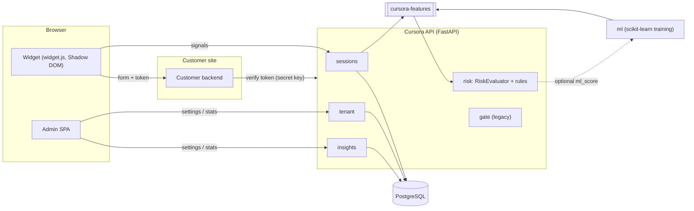

# Architecture

- **Widget**: embedded with `<script src=".../widget.js" data-site-key="...">`. It renders
  in a Shadow DOM so host-page CSS can't affect it, collects signals, shows a challenge
  when one is needed and, after a pass, puts a short-lived verification token into the
  host page's form.
- **Customer backend**: sends the token with the site's secret key to the Cursora verify
  API and accepts the protected action only if the token is valid; each token is accepted
  once ([ADR 0002](adr/0002-token-verification-integration.md)). The token format and the
  module that issues and verifies tokens are still `TODO(team)`.
- **Nginx**: only a reverse proxy for Cursora's own services (admin, `widget.js`, `/api/`).
  It holds no business logic. The `gate` module and the sample site's `auth_request`
  config are left from the earlier design and are replaced by token verification.
- **API**: a modular monolith, one module per bounded context (`tenant`, `sessions`, `risk`,
  `gate`, `insights`). `RiskEvaluator` is pure and deterministic. It combines rules, the
  site's sensitivity (0–100) and an optional ML score into allow / challenge / block.
- **cursora-features**: a single feature-extraction implementation used for both serving
  (api) and training (ml).
- **Admin**: sites (domain, allowed origins, keys), one sensitivity value per site and
  aggregate statistics.
- **PostgreSQL**: the only datastore (JSONB for flexible signal data). No Redis.

Open decisions (status codes, signals, rules, thresholds) are marked `TODO(team)` in the code.
