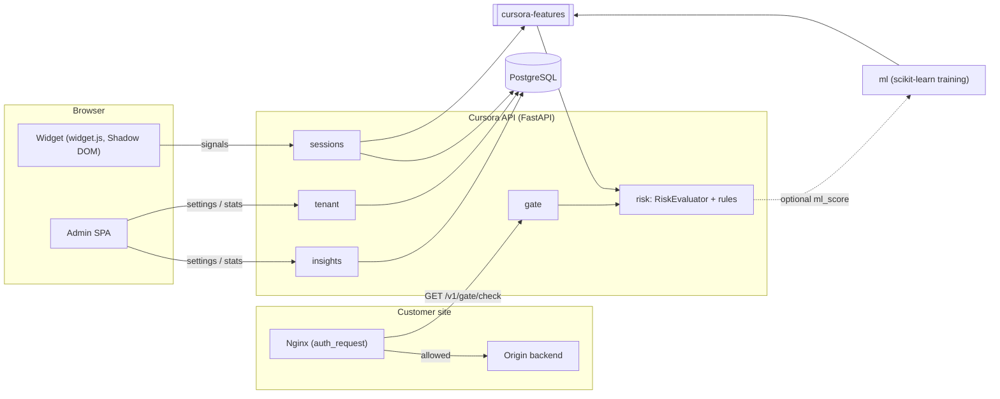

# Architecture

- **Widget**: embedded with `<script src=".../widget.js" data-site-key="...">`. It renders
  in a Shadow DOM so host-page CSS can't affect it, collects signals and shows a challenge
  when one is needed.
- **Nginx**: for protected routes it makes a subrequest to `GET /v1/gate/check` and lets
  the request through or not based on the status. Unprotected routes go straight to the
  origin. Nginx holds no business logic.
- **API**: a modular monolith, one module per bounded context (`tenant`, `sessions`, `risk`,
  `gate`, `insights`). `RiskEvaluator` is pure and deterministic. It combines rules, the
  site's sensitivity (0–100) and an optional ML score into allow / challenge / block.
- **cursora-features**: a single feature-extraction implementation used for both serving
  (api) and training (ml).
- **Admin**: one sensitivity value per site and aggregate statistics.
- **PostgreSQL**: the only datastore (JSONB for flexible signal data). No Redis.

Open decisions (status codes, signals, rules, thresholds) are marked `TODO(team)` in the code.
