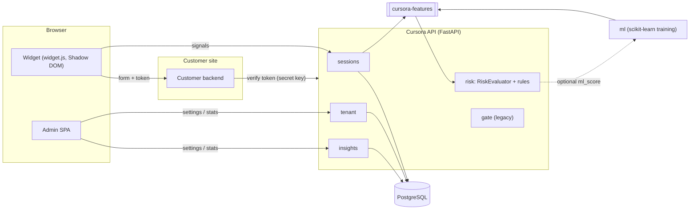

# Architecture

- **Widget**: embedded with `<script src=".../widget.js" data-site-key="...">`. It renders
  in a Shadow DOM so host-page CSS can't affect it, collects signals, shows a challenge
  when one is needed and, after a pass, puts a short-lived verification token into the
  host page's form.
- **Customer backend**: sends the token with the site's secret key to the Cursora verify
  API and accepts the protected action only if the token is valid; each token is accepted
  once ([ADR 0002](adr/0002-token-verification-integration.md)). Which module issues and
  verifies tokens is still `TODO(team)`.
- **Nginx**: only a reverse proxy for Cursora's own services (admin, `widget.js`, `/api/`).
  It holds no business logic. The `gate` module and the sample site's `auth_request`
  config are left from the earlier design and are replaced by token verification.
- **API**: a modular monolith, one module per bounded context (`tenant`, `sessions`, `risk`,
  `gate`, `insights`). `RiskEvaluator` is pure and deterministic. It combines rules, the
  site's sensitivity (0–100) and an optional ML score into allow / challenge / block.
- **cursora-features**: a single feature-extraction implementation used for both serving
  (api) and training (ml).
- **Admin**: sites (domain, allowed origins, keys), one sensitivity value per site and
  aggregate statistics.
- **PostgreSQL**: the only datastore (JSONB for flexible signal data). No Redis.

## Data model

| Table             | Module   | Holds                                                                                                                                           |
| ----------------- | -------- | ----------------------------------------------------------------------------------------------------------------------------------------------- |
| `sites`           | tenant   | Domain, allowed origins, unique public site key, SHA-256 hash of the secret key (the secret itself is shown once), sensitivity 0–100.           |
| `widget_sessions` | sessions | The session id from the HttpOnly cookie, its site, state (`new` / `challenge_required` / `verified` / `blocked`) and `expires_at`.              |
| `signal_batches`  | sessions | One widget batch of behavioural signals as JSONB, with its session id and site.                                                                 |
| `decisions`       | risk     | One Risk Engine assessment: decision, score, optional ML score, the sensitivity in force and the client's /24 or /48 prefix, never the full IP. |

The widget sends its site key when it opens a session, and every session belongs to that one
site.

## Signal ingestion

The widget sends a batch of signals every 2 s while there are new ones, when 100 are buffered,
when the visitor ticks the checkbox and when the page is hidden, to
`POST /v1/sessions/signals`. The browser attaches the session cookie. Each batch carries the time
on page (`t`) and a list of `move`, `click` and coarse `env` signals; the API accepts nothing
else, so typed text, form values and fingerprint attributes cannot reach the database. The API
checks, in this order:

1. a live session in the cookie, or `401`: the widget opens a new session and drops the batch;
2. the batch rate of the session, or `429` with `Retry-After`;
3. the body size, read no further than the limit, or `413`;
4. the shape, or `422`; then the number of signals, or `413`.

A stored batch gets `204`. Rejections for size or rate are counted in
`widget_sessions.rejected_signal_batches`, a request signal for the Risk Engine. The limits are
settings (`CURSORA_SIGNAL_*` in `.env.example`) with placeholder values until the team decides
them. `signal_batches` and `decisions` keep `session_id` as a plain column without a foreign key,
so they stay grouped after the session row is deleted (BR-44 in
[project-context.md](project-context.md)). Deleting a site deletes all its rows. The retention
clean-up and the admin API for sites are still to come; for local development,
`pnpm api:create-site --domain localhost` registers a site and prints its keys.

Open decisions (status codes, signals, rules, thresholds) are marked `TODO(team)` in the code.
